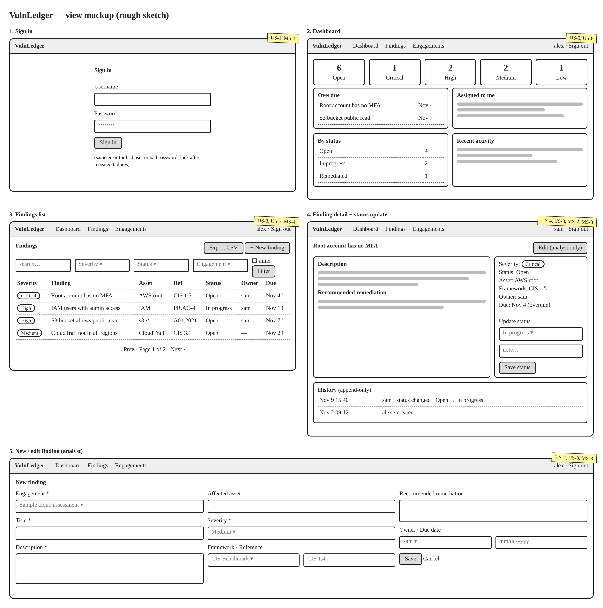
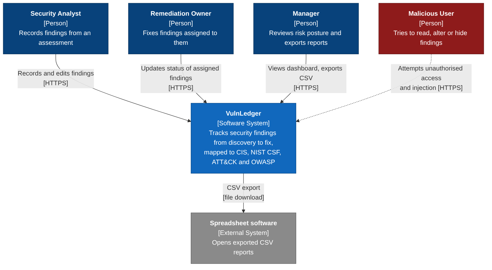
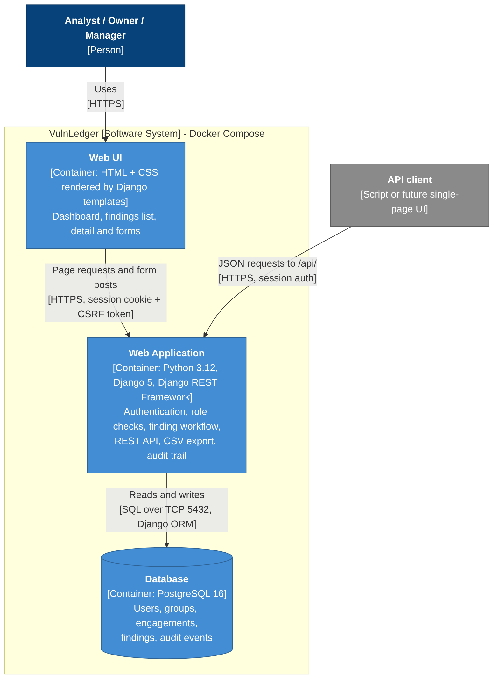
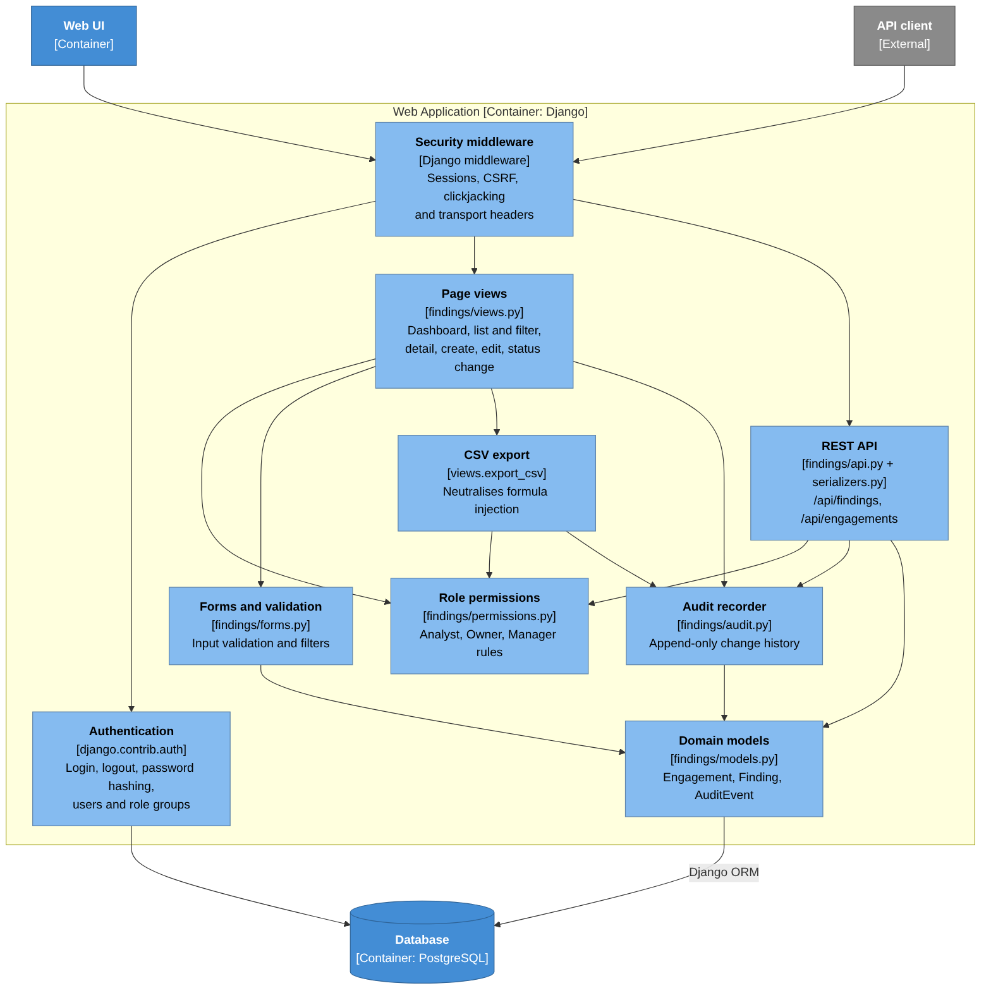

# VulnLedger design documentation

- [User stories](#user-stories)
- [Mis-user stories](#mis-user-stories)
- [Mockup](#mockup)
- [Architecture diagrams](#architecture-diagrams)

Roles used below:

| Role | Who they are |
|------|--------------|
| **Security analyst** | Performs assessments and records what was found |
| **Remediation owner** | The administrator or developer responsible for fixing a finding |
| **Manager** | Accountable for risk; reviews progress and reports upward |

## User stories

### US-1: Sign in
As a **registered user**, I want to **sign in with my own account** so I can
**see findings that must not be public and have my actions attributed to me**.

Acceptance criteria:
- Every page and API endpoint except the sign-in page redirects or refuses an unauthenticated visitor.
- After a successful sign-in the user lands on the dashboard and sees their username in the header.
- A user can sign out, after which the session can no longer be used.

### US-2: Record a finding
As a **security analyst**, I want to **record a finding with a title, description, severity and affected asset**
so I can **keep every issue from an assessment in one place instead of a static report**.

Acceptance criteria:
- An analyst can create a finding under an engagement; title, description, severity and engagement are required.
- The saved finding appears in the findings list and records who reported it and when.
- A user who is not an analyst is refused when attempting to create or edit a finding.

### US-3: Map a finding to a security framework
As a **security analyst**, I want to **tag a finding with a framework and control reference (CIS, NIST CSF, MITRE ATT&CK, OWASP Top Ten)**
so I can **show which recognized requirement the finding violates and report by framework**.

Acceptance criteria:
- The finding form offers the four frameworks and a free-text reference such as `CIS 1.5` or `A01:2021`.
- A reference cannot be saved without choosing its framework.
- The reference is shown in the findings list, on the detail page and in the CSV export, and is searchable.

### US-4: Update the status of my finding
As a **remediation owner**, I want to **change the status of a finding assigned to me and leave a note**
so I can **show progress and close the finding once it is fixed**.

Acceptance criteria:
- The owner of a finding can set it to Open, In progress, Remediated, Risk accepted or False positive.
- The change and optional note appear in the finding's history with the owner's username and a timestamp.
- The status control is not offered on findings assigned to someone else.

### US-5: See risk at a glance
As a **manager**, I want to **see how many findings are open at each severity**
so I can **judge current risk and decide where to spend remediation effort**.

Acceptance criteria:
- The dashboard shows a count of open findings in total and for Critical, High, Medium and Low.
- Closed findings (Remediated, Risk accepted, False positive) are excluded from the open counts.
- Selecting a severity tile opens the findings list filtered to that severity.

### US-6: Know what is overdue and what is mine
As a **remediation owner**, I want to **see the findings assigned to me and which findings are past their due date**
so I can **work on the most urgent items first**.

Acceptance criteria:
- The dashboard lists open findings assigned to the signed-in user.
- The dashboard lists open findings whose due date has passed, oldest first, with their owner.
- Overdue dates are visually highlighted in the list and detail views.

### US-7: Filter and export findings
As a **manager**, I want to **search and filter findings and export the result as CSV**
so I can **include current status in reports for leadership or auditors**.

Acceptance criteria:
- Findings can be filtered by severity, status, engagement, "assigned to me" and a text search.
- Export CSV downloads exactly the findings matching the current filters.
- Only analysts and managers can export.

### US-8: Review the history of a finding
As a **manager**, I want to **see who created, edited or changed the status of a finding and when**
so I can **trust the record and answer questions during an audit**.

Acceptance criteria:
- Each finding shows a chronological history of creation, edits and status changes with actor and time.
- History entries cannot be edited or removed through the application or its admin site.

## Mis-user stories

### MS-1: Guess a password
As an **outside attacker**, I want to **repeatedly guess passwords on the sign-in page** so I can
**take over an account and read an organization's unfixed vulnerabilities**.

Mitigation criteria:
- Passwords must be at least 12 characters and are checked against common-password and similarity rules; they are stored only as salted hashes. *(implemented)*
- A failed sign-in shows the same message whether the username or the password was wrong. *(implemented)*
- Repeated failures from one account or address are throttled or temporarily locked out. *(planned for the next milestone)*

### MS-2: Close findings that are not mine
As a **dishonest remediation owner**, I want to **mark findings assigned to other people (or edit a finding's severity) myself**
so I can **make the numbers look better without doing the work**.

Mitigation criteria:
- The server refuses a status change unless the user is the finding's owner or an analyst, even if the request is crafted by hand. *(implemented, tested)*
- Only analysts can edit a finding's content, severity or owner, in both the pages and the API. *(implemented, tested)*
- Every status change is recorded in the history with the actor, so misuse is attributable. *(implemented, tested)*

### MS-3: Inject a script into a finding
As a **malicious insider**, I want to **put JavaScript or SQL into a finding's title, description or note**
so I can **steal another user's session or tamper with the database when they view it**.

Mitigation criteria:
- All user-supplied text is HTML-escaped when rendered; no template marks user input as safe. *(implemented, tested)*
- All database access goes through the ORM with parameterized queries; no raw SQL is built from input. *(implemented)*
- Session cookies are `HttpOnly`, so script cannot read them. *(implemented)*

### MS-4: Weaponize the export
As a **malicious insider**, I want to **save a finding whose title is a spreadsheet formula**
so I can **run commands or exfiltrate data on a manager's computer when they open the CSV export**.

Mitigation criteria:
- Any exported cell beginning with `=`, `+`, `-` or `@` is prefixed so spreadsheet software treats it as text. *(implemented, tested)*
- Export is limited to analysts and managers, and each export is written to the audit trail. *(implemented, tested)*

### MS-5: Forge a request from another site
As an **outside attacker**, I want to **trick a signed-in analyst into visiting a page that silently submits a status change**
so I can **close critical findings without having an account**.

Mitigation criteria:
- Every state-changing request requires a valid CSRF token; the status endpoint accepts only `POST`. *(implemented, tested)*
- Session cookies use `SameSite=Lax`, and pages cannot be framed by other sites (`X-Frame-Options: DENY`). *(implemented)*

### MS-6: Erase the evidence
As a **malicious insider**, I want to **delete a finding or its history**
so I can **hide that a vulnerability was reported and ignored**.

Mitigation criteria:
- Findings cannot be deleted through the pages or the API; they can only be closed with a status. *(implemented, tested)*
- Audit events are read-only in the admin site (no add, change or delete). *(implemented)*

## Mockup

A rough sketch of the five main views. The yellow tags show which user and
mis-user stories each view supports. Editable source:
[`diagrams/mockup.html`](diagrams/mockup.html).

## Architecture diagrams

The diagrams follow the [C4 model](https://c4model.com/). Editable
[Mermaid](https://mermaid.js.org/) sources are in [`diagrams/`](diagrams/).

### Level 1: System context

Who uses VulnLedger and what it connects to.

### Level 2: Containers

The deployable pieces, all started by Docker Compose.

### Level 3: Components

The parts of the Django web application and how a request flows through them.

